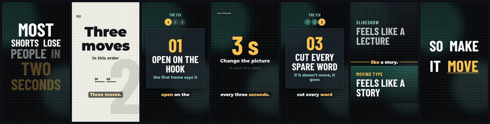

# shorts-motion

A Claude Code skill for making vertical (1080x1920) explainer Shorts with
[HyperFrames](https://github.com/heygen-com/hyperframes), HeyGen's open-source HTML-to-video renderer: animated
graphic layouts timed to the spoken words, an optional talking-head or cut-out presenter, burned-in word captions,
and a **measured design critic** that fails a cut before anyone sees it.



The workflow it teaches Claude: write `scenes.json`, build, render, run the critic, fix, repeat until it passes.

## Why

Most AI-made Shorts fail in the same few ways: a small head in a corner over an empty frame, the same two graphic
types in rotation, text too small to read on a phone, and everything slowly zooming like a slideshow. Taste is hard
to automate, but those failures are measurable, so the critic measures them from the rendered MP4: the largest
empty region, every text line's height, the face size, caption collisions, layout repeats and variety, how long the
picture holds still, and whether the first frame carries the hook.

The motion check (is it moving like a slideshow?) was calibrated on our own posted cuts and 60 viral Shorts in our
niches (35 breakouts and 25 typical posts for comparison). The viral ones had almost no slow uniform zoom and about
two push-ins a minute; ours had zoom on a quarter of the runtime and nearly three times the push-ins, and on our own
posts more slow zoom went with fewer views. So the layouts here hold still while they build, and the critic warns
when a cut drifts. The numbers are in [`scripts/motion/README.md`](scripts/motion/README.md).

## Install

```bash
# copy the folder into your Claude Code skills
git clone https://github.com/ericsnyder2025/shorts-motion ~/.claude/skills/shorts-motion
# or
npx skills add ericsnyder2025/shorts-motion
```

Then ask Claude Code for a Short ("make a 30-second Short explaining X from this script"); it picks the skill up from
`SKILL.md`.

## Requirements

- macOS for the full kit (the system voice for narration, Apple Vision for the text and face rules). Nothing in
  the build, the render, the video rules or the motion check is macOS-specific, but only macOS has been tested.
- Python 3.9+ with `numpy`, `Pillow` and `opencv-python-headless`: `pip3 install numpy Pillow opencv-python-headless`
- `ffmpeg` and `ffprobe`
- Node 22+ (`npx` fetches `hyperframes@0.8.79` on first use; it renders with its own headless Chrome)
- Optional: Xcode command line tools (`swiftc`) for exact word timings from the macOS voice and for the Vision probe;
  `mlx-whisper`, `openai-whisper` or `faster-whisper` to time a recording of your own voice; `espeak-ng` as a local
  voice on Linux.

No paid services, no API keys. HyperFrames records anonymous usage telemetry by default; turn it off with
`npx hyperframes@0.8.79 telemetry disable`.

## Quickstart

```bash
~/.claude/skills/shorts-motion/scripts/demo.sh ./shorts-motion-demo
```

It voices `examples/demo/script.txt` with the local system voice, builds and renders the 18-second example
(kinetic, pages, steps, stat, compare), and runs the critic: `shorts-motion-demo/demo.mp4` and
`shorts-motion-demo/critic/critic-sheet.png`. About 30 seconds on a recent Mac.

By hand, in a folder with your `script.txt`:

```bash
S=~/.claude/skills/shorts-motion/scripts
python3 $S/words.py say script.txt --out voice.wav --words words.json     # or: transcribe voice.wav / estimate
# write scenes.json (see SKILL.md)
python3 $S/build.py scenes.json --validate
python3 $S/build.py scenes.json --out project --render short.mp4
python3 $S/critic.py short.mp4 --plan project/scene-plan.json --out critic
```

## Layouts

| Layout | For |
|---|---|
| `kinetic` | the hook, the lesson line, a reversal: big type that builds word by word on the voice |
| `pages` | a run of short beats as slides: the key word slams in, the next page wipes in behind a colour band, a giant numeral and a progress track |
| `stat` | one number that matters, counting up on its word |
| `steps` | a numbered list told one item at a time |
| `flow` | a chain or process, node by node |
| `checklist` | checks that tick on their words |
| `compare` | before and after, this vs that |
| `quote` | a line worth pausing on, with a marker sweep |
| `phone` | a screen in a phone |

And with footage: `cutaway` (a full-frame image, clip or scrolling code file), `avatar` (the presenter full frame),
`split` (the presenter in one half, a layout or picture in the other) and `stack` (the cut-out presenter in front of a
background). The presenter is optional: bring a 9:16 take of yourself saying the script, and a background-removed
copy for `stack`. Every field is in [`SKILL.md`](SKILL.md) and [`references/layouts.md`](references/layouts.md).

Colours, fonts and the background texture come from [`theme.json`](theme.json); point a spec at your own (a partial
file merges over the default).

## The critic

| Code | Level | Fails or warns when |
|---|---|---|
| VOID | fail | one empty region covers over 22% of the frame |
| TEXT | fail | a text line is under 40 px tall (labels like "demo" may be 26) |
| WALL | fail | over 9 lines of text on a frame besides the caption |
| HEAD | fail | the presenter's face is under 13% of the frame height |
| COLLIDE | fail | graphic text touches the caption |
| REPEAT | fail | the same layout twice in a row, or two scenes that look the same |
| VARIETY | fail | fewer than min(5, scenes / 2 + 1) distinct layouts |
| HOG | fail | one non-presenter layout fills over 40% of the runtime |
| STALE | fail | 6 s with no picture change (warns at 4.5) |
| FACE | fail | with a presenter, they are on screen outside 10-20% of the runtime (profiles change the range) |
| OPEN | fail | the first frame has neither the presenter nor the hook in big type |
| BLANK | fail | a blank picture for 0.3 s or more mid-video |
| DRIFT | warn | slow uniform zoom over 40% of the runtime |
| PUSH | warn | over 8 push-ins a minute |
| DEAD | warn | a flat, unchanging background over 25% of the frame |

Each finding names the scene and the time; the sheet shows a frame per scene bordered green, amber or red. A scene
can be excused from a frame rule with `"allow": ["VOID"]` and a `"why"`, which every report prints. Without Apple
Vision (Linux, or `--no-probe`) the text and face rules are skipped with a note and the rest still runs. Details and
fixes: [`references/critic.md`](references/critic.md).

## Tests

```bash
python3 -m unittest discover -s tests
```

Layout HTML, spec validation, scene anchoring and captions, the critic's frame rules and the motion thresholds. No
network; one test renders a short clip with ffmpeg if it is installed.

## What it is not (yet)

- Transitions are hard cuts only; no music bed or sound effects (add them in HyperFrames, or after).
- It does not make presenter footage. Bring your own take, of yourself or of someone who agreed to it.
- The critic measures hygiene, not taste. Look at the sheet.

## Credits

Made by Eric Snyder (Receipts Group), adapted from his own production stack.

- [huashu-art-motion](https://github.com/alchaincyf/huashu-art-motion) (MIT, Copyright (c) 2026 alchaincyf):
  `scripts/motion/film_gate.py` is vendored unchanged, and the `pages` layout is adapted from its y5 kinetic type.
- [HyperFrames](https://github.com/heygen-com/hyperframes) (Apache-2.0), HeyGen's HTML-to-video renderer, used as a
  dependency through `npx`; nothing of it is included here.
- Montserrat and Barlow Condensed (SIL Open Font License 1.1), in `fonts/` with their licences.
- [GSAP](https://gsap.com), downloaded at build time under its own licence; not included.

MIT licence, see [`LICENSE`](LICENSE) and [`NOTICE`](NOTICE).
